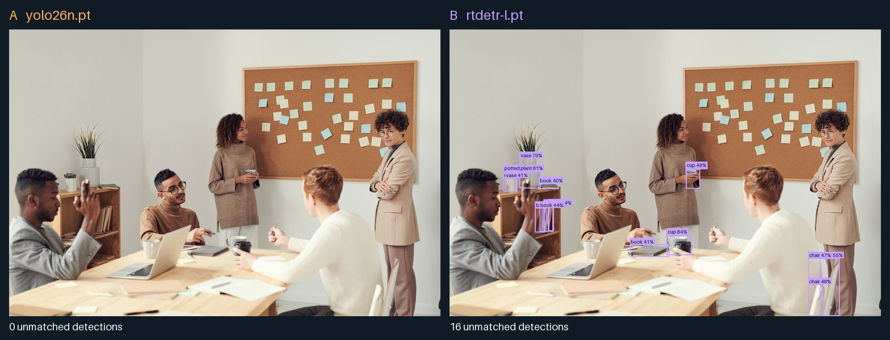

# YOLO Vision Studio

YOLO Vision Studio is a Streamlit app for exploring what a vision model sees in a photo and how its predictions change across a video. You can inspect a single detection, compare a box with a segmentation mask, or follow an object by its tracking ID across frames.

I started with the detection and tracking app from CodingMantras / Aparsoft. I added **Compare Models** to answer a question I couldn't answer from a single annotated image: when I switch detectors, which objects actually change? The comparison workflow pairs boxes across models, isolates disagreements, and exports the evidence for every image in a batch. I also updated the Linux graphics packages and the webcam and CLIP dependencies. [Original project](https://github.com/CodingMantras/yolov8-streamlit-detection-tracking)

## Two detectors, one office photo

At 40% confidence and a match IoU of 0.50, YOLO26 Nano returned **9 boxes** and RT-DETR-Large returned **25**. All 9 Nano boxes had a same-class match, including 5 people. Among RT-DETR's 16 additional boxes were 7 books, 3 chairs and 3 cups. The panels below show only unmatched predictions, which is why the Nano panel is clear. The photo has no ground-truth labels for scoring accuracy. [Full detection and timing report](examples/office-report.json)



Choose **Compare Models** in the sidebar. Pick two detectors, keep the office photo or upload a batch, and click **Run comparison**. Sort the batch table by **Only B** to find images worth inspecting. Select an image and switch between **All**, **Matched**, **Only A**, and **Only B** without rerunning inference.

Boxes match when their class names agree and their intersection-over-union reaches the selected threshold. The matcher takes the highest overlap first and uses each box once. The JSON export records the input hashes, checkpoints, settings, package versions, device, per-image inference times, raw boxes, pair indices, and per-class counts. Each detector gets one warm-up prediction. Timings cover the model's inference stage and vary with hardware and load.

## Run locally

From the repository root, create a virtual environment and start Streamlit. The commands below use a Linux or macOS shell. Git is required to install the CLIP dependency.

```bash
python3 -m venv .venv
source .venv/bin/activate
python -m pip install -r requirements.txt
python -m streamlit run app.py
```

Open the local URL printed by Streamlit. The first time you select a model, the app looks for its checkpoint in `weights/` and downloads missing weights through Ultralytics. Allow internet access for that first download.

To regenerate the office figure and JSON report, run `python -m examples.office_comparison` from the repository root. To run the comparison regression tests, use `python -m unittest discover -s tests -v`.

## Try it with the included media

1. **Inspect the office photo.** Choose **Image Inference → Detection**. The initial view shows a saved example. Upload [the original office photo](images/office_4.jpg) and click **Run Detection** to generate a fresh result. Raise **Model Confidence** and run it again to see which boxes drop out. The results table shows the class and confidence for each remaining detection.
2. **Compare boxes and masks.** With the same photo, switch to **Segmentation** to see the pixels assigned to each object. To look for particular categories, choose **YOLOE (Text → Segmentation)** and enter a comma-separated list such as `chair, laptop`. **YOLO World v2** accepts text prompts for boxes, while **Pose Estimation** draws keypoints on people.
3. **Follow an object through a clip.** Choose **Video Inference → Detection**, select **Stored Video**, and pick one of the three bundled clips. Enable ByteTrack or BoT-SORT to display tracking IDs. The unique-object count accumulates distinct IDs across processed frames, so an object that keeps its ID counts once even when it appears in many frames.

Video mode also accepts a browser webcam, an RTSP stream, or a YouTube URL. For a slow video run, increase the frame-skip setting to process fewer frames.

## Where to make changes

The sidebar and mode selection live in [app.py](app.py). To add a model to the selector or change the default confidence threshold, edit [config.py](config.py). [model_loader.py](model_loader.py) handles checkpoints and model caching. Image uploads and result tables live in [image_service.py](image_service.py), while video sources, tracking, and frame processing live in [video_service.py](video_service.py).

## License

This repository includes the [Apache License 2.0](LICENSE).
