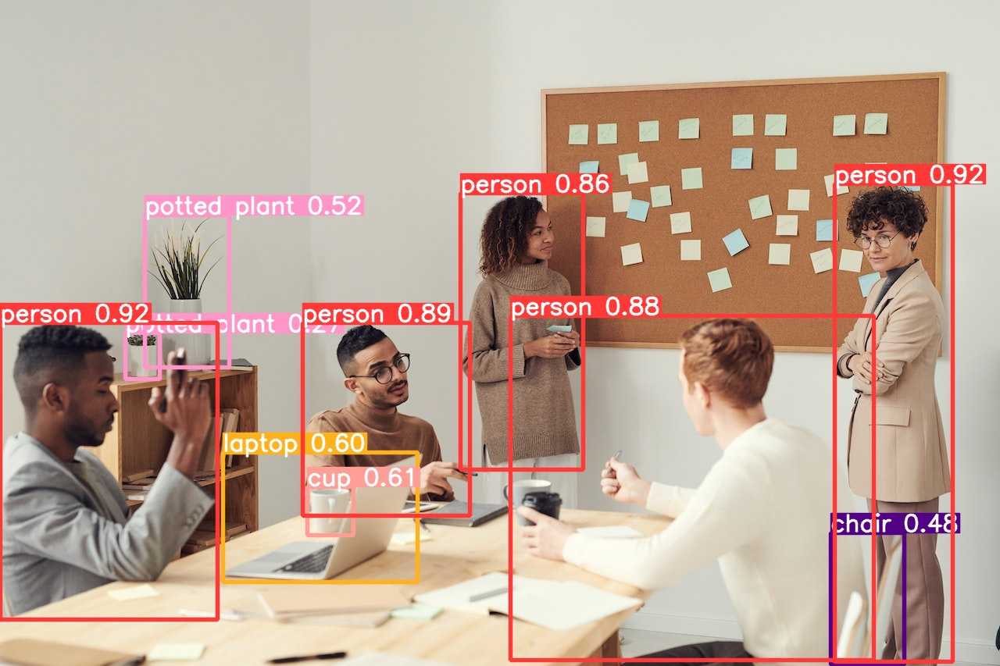

# YOLO Vision Studio

YOLO Vision Studio is a Streamlit app for exploring what a vision model sees in a photo and how its predictions change across a video. You can inspect a single detection, compare a box with a segmentation mask, or follow an object by its tracking ID across frames.

I started with the detection and tracking app from CodingMantras / Aparsoft. My changes in this version focus on the runtime setup. I updated the Linux graphics packages used for deployment and added explicit Python dependencies for browser webcam input and CLIP text prompts. [Original project](https://github.com/CodingMantras/yolov8-streamlit-detection-tracking)



## Run locally

From the repository root, create a virtual environment and start Streamlit. The commands below use a Linux or macOS shell. Git is required to install the CLIP dependency.

```bash
python3 -m venv .venv
source .venv/bin/activate
python -m pip install -r requirements.txt
python -m streamlit run app.py
```

Open the local URL printed by Streamlit. The first time you select a model, the app looks for its checkpoint in `weights/` and downloads missing weights through Ultralytics. Allow internet access for that first download.

## Try it with the included media

1. **Inspect the office photo.** Choose **Image Inference → Detection**. The initial view shows a saved example. Upload [the original office photo](images/office_4.jpg) and click **Run Detection** to generate a fresh result. Raise **Model Confidence** and run it again to see which boxes drop out. The results table shows the class and confidence for each remaining detection.
2. **Compare boxes and masks.** With the same photo, switch to **Segmentation** to see the pixels assigned to each object. To look for particular categories, choose **YOLOE (Text → Segmentation)** and enter a comma-separated list such as `chair, laptop`. **YOLO World v2** accepts text prompts for boxes, while **Pose Estimation** draws keypoints on people.
3. **Follow an object through a clip.** Choose **Video Inference → Detection**, select **Stored Video**, and pick one of the three bundled clips. Enable ByteTrack or BoT-SORT to display tracking IDs. The unique-object count accumulates distinct IDs across processed frames, so an object that keeps its ID counts once even when it appears in many frames.

Video mode also accepts a browser webcam, an RTSP stream, or a YouTube URL. For a slow video run, increase the frame-skip setting to process fewer frames.

## Where to make changes

The sidebar and mode selection live in [app.py](app.py). To add a model to the selector or change the default confidence threshold, edit [config.py](config.py). [model_loader.py](model_loader.py) handles checkpoints and model caching. Image uploads and result tables live in [image_service.py](image_service.py), while video sources, tracking, and frame processing live in [video_service.py](video_service.py).

## License

This repository includes the [Apache License 2.0](LICENSE).
